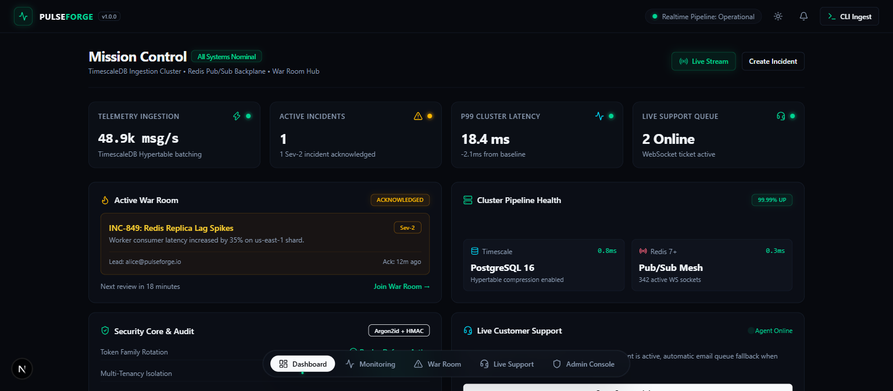
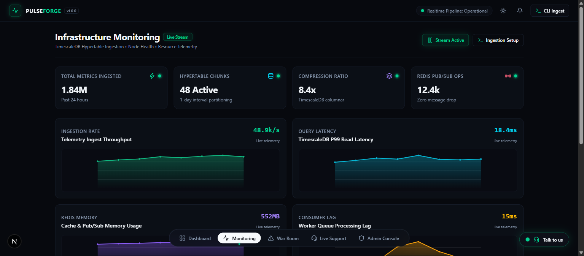
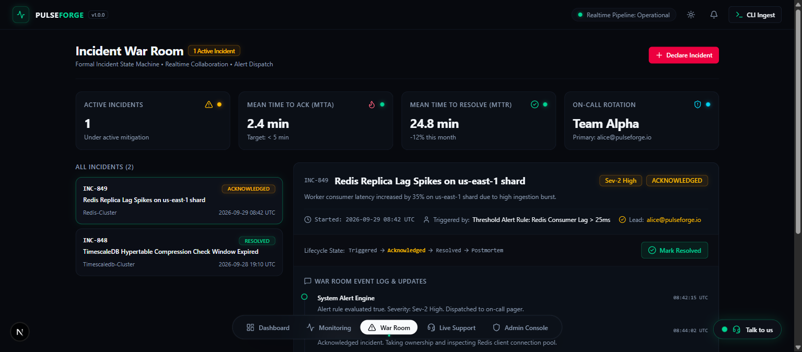
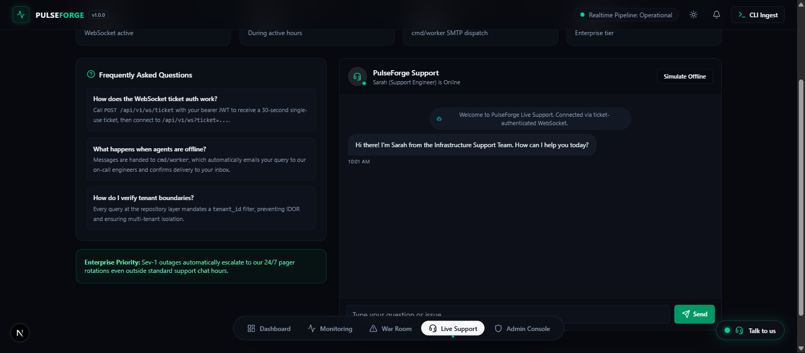
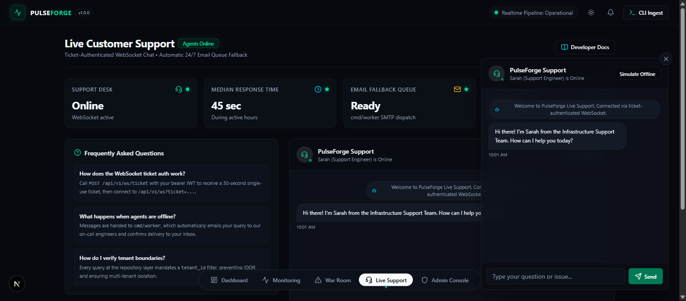
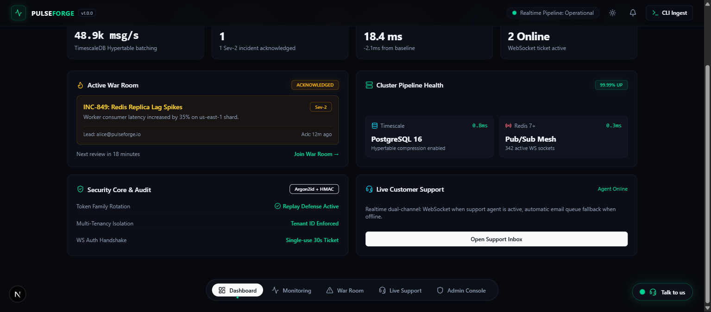
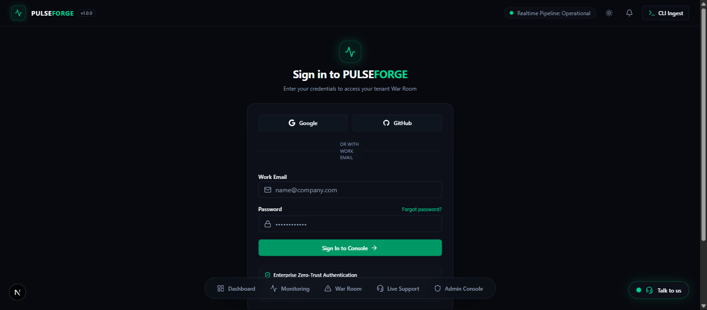

# PulseForge

<div align="center">



### Enterprise Multi-Tenant Infrastructure Monitoring, Incident War Room & Live Customer Support

[](https://go.dev/)
[-black?style=flat-square&logo=next.js)](https://nextjs.org/)
[](https://www.timescale.com/)
[](https://redis.io/)
[](https://tailwindcss.com/)
[](LICENSE)
[](internal/core/domain)

</div>

---

## Overview

**PulseForge** is an enterprise-grade, multi-tenant B2B SaaS platform engineered for cloud-native infrastructure teams. It fuses **high-throughput time-series telemetry monitoring**, a **formal Incident War Room lifecycle engine**, and **ticket-authenticated live customer support with automated email fallback** into a unified mission control surface.

Designed with strict zero-trust security invariants, PulseForge enforces mandatory tenant boundaries at the database repository layer (primary IDOR defense), Argon2id cryptographic hashing, token family rotation with replay-attack detection, and an ultra-fast obsidian-dark interface.

---

## Visual Showcase

### 1. Mission Control Overview
High-density overview combining active incident alerts, TimescaleDB ingestion rates, P99 cluster latency, and live pipeline status.


### 2. Real-Time Infrastructure Monitoring
Interactive sparkline area charts for telemetry throughput, TimescaleDB read latency, Redis cache usage, and worker lag, alongside compute node health tracking.


### 3. Incident War Room & Lifecycle Engine
Formal state machine enforcement (`Triggered` &rarr; `Acknowledged` &rarr; `Resolved` &rarr; `Postmortem`) with chronological event logging and responder ownership.


### 4. Live Customer Support & Help Desk
Dual-channel customer assistance featuring real-time WebSocket chat and automatic fallback to background worker email queueing when agents are offline.


### 5. Floating Global Support Widget
Everywhere-accessible floating widget with pulsating status indicator, allowing instant support communication from any view in the platform.


### 6. Admin Super-Console
Cross-tenant user governance, session revocation (token family invalidation in Redis), Go runtime telemetry, immutable audit trail, and system broadcasts.


### 7. Enterprise Authentication
Zero-Trust login supporting Email & Password with Argon2id hashing, Google & GitHub OAuth2 federation, and token family rotation defense.


---

## Core Capabilities

### ⚡ Telemetry Ingestion & TimescaleDB Hypertables
- High-throughput ingestion endpoint (`POST /api/v1/ingest`) authenticated via per-tenant API keys.
- Automatic TimescaleDB hypertable batching, 1-day chunk interval partitioning, and columnar compression policies.
- Real-time threshold evaluation powering the alert and incident pipeline.

### 🚨 Incident War Room State Machine
- Strict state transitions enforced in pure domain logic (`internal/core/domain/incident`):
  $$\text{Triggered} \longrightarrow \text{Acknowledged} \longrightarrow \text{Resolved} \longrightarrow \text{Postmortem}$$
- Disallowed state transitions (e.g. jumping directly from triggered to postmortem) are rejected at the domain boundary.
- Real-time collaboration log, incident severity classification (Sev-1 Critical to Sev-4 Low), and MTTA/MTTR analytics.

### 💬 Dual-Channel Live Customer Support
- **Online Channel**: Real-time WebSocket chat authenticated via short-lived, single-use 30-second tickets (`POST /api/v1/ws/ticket`) and distributed across multi-pod clusters using Redis Pub/Sub.
- **Offline Fallback**: When support staff is offline, messages degrade gracefully to `cmd/worker`, which dispatches transactional notification emails to the on-call queue and confirms delivery to the user.

### 🛡️ High-Security Zero-Trust Subsystem
- **Password Security**: Argon2id ($m=64\text{MB}, t=3, p=4$) with unique per-user cryptographic salts.
- **Token Family Rotation**: Short-lived JWT access tokens (15m) paired with opaque UUID refresh tokens (7d) stored in `httpOnly`, `Secure`, `SameSite=Strict` cookies.
- **Replay Attack Detection**: Reusing an expired/rotated refresh token revokes the entire family in Redis instantly and logs a critical security audit event.
- **Multi-Tenant Isolation**: Mandatory `tenant_id` parameter verification on all repository operations to prevent Insecure Direct Object References (IDOR).

---

## Architecture & Tech Stack

```
                          ┌─────────────────────────────────────┐
                          │     Next.js 16 (Turbopack) UI       │
                          │   Tailwind CSS v4 + Shadcn UI       │
                          └──────────────────┬──────────────────┘
                                             │ REST / WebSocket
                                             ▼
                          ┌─────────────────────────────────────┐
                          │   PulseForge API Gateway (Go 1.26)  │
                          │      Clean / Hexagonal Engine       │
                          └──────┬───────────┬───────────┬──────┘
                                 │           │           │
                 ┌───────────────┘           │           └───────────────┐
                 ▼                           ▼                           ▼
  ┌─────────────────────────────┐  ┌───────────────────┐  ┌─────────────────────────────┐
  │  PostgreSQL 16+TimescaleDB  │  │   Redis 7+ Mesh   │  │   PulseForge Worker Daemon  │
  │   - Multi-tenant schemas    │  │ - Session store   │  │ - Alert rule evaluator      │
  │   - Metric hypertables      │  │ - WS backplane    │  │ - Transactional email       │
  │   - Immutable audit logs    │  │ - Token families  │  │ - Support email fallback    │
  └─────────────────────────────┘  └───────────────────┘  └─────────────────────────────┘
```

| Layer | Technology | Specification Details |
| :--- | :--- | :--- |
| **Backend Language** | Go 1.25+ / Go 1.26 | Pinned toolchain, Clean/Hexagonal structure, zero framework leak into `usecase` |
| **Primary Database** | PostgreSQL 16 + TimescaleDB | Community Edition hypertable partitioning, retention & columnar compression |
| **Cache & Pub/Sub** | Redis 7+ | Token family revocation, rate limiting, WS ticket store, pub/sub cluster mesh |
| **WebSockets** | Gorilla WebSocket | Decoupled behind provider-agnostic `realtime.Hub` interface |
| **Frontend Framework** | Next.js 16 (Active LTS) | App Router, TypeScript, React 19, Turbopack |
| **Styling & Design** | Tailwind CSS v4 | Obsidian luxury dark default theme, restrained neon glow accents |
| **Functional UI** | Shadcn UI | Radix UI primitives: tables, dialogs, tabs, inputs, dropdowns |
| **Decorative UI** | Vengeance UI | Bento grid shell, glow borders, animated counters, glassmorphism dock |
| **Data Fetching** | Axios + Interceptors | Silent JWT refresh queue collapsing parallel 401s into single refresh |
| **Containerization** | Docker & Compose | Multi-stage minimal builds (Alpine/Scratch, standalone output) |

---

## Repository Structure

```
pluseforge/
├── cmd/
│   ├── api/                     # HTTP REST & WebSocket service entrypoint
│   └── worker/                  # Background worker daemon (alerts, email, dispatch)
├── internal/
│   ├── core/
│   │   ├── domain/              # Pure domain entities, enums & repository interfaces
│   │   │   ├── incident/        # Formal incident state machine & transitions
│   │   │   ├── metric/          # Telemetry point definitions & alert thresholds
│   │   │   ├── realtime/        # Provider-agnostic realtime.Hub interface
│   │   │   ├── support/         # Customer support conversations & messages
│   │   │   ├── tenant/          # Multi-tenant boundary contracts
│   │   │   └── user/            # RBAC roles, token families & audit logs
│   │   └── usecase/             # Pure business logic (zero framework dependencies)
│   ├── adapter/
│   │   ├── delivery/
│   │   │   ├── http/v1/         # Chi router, handlers, middleware, health probes
│   │   │   └── ws/              # Gorilla WebSocket adapter implementing realtime.Hub
│   │   └── repository/          # PostgreSQL (TimescaleDB) & Redis implementations
│   └── platform/
│       ├── config/              # Strong-typed environment config & validation
│       ├── database/            # pgxpool PostgreSQL & Redis 7 clients
│       ├── logger/              # Standard library log/slog structured logging
│       └── mailer/              # Transactional SMTP delivery client
├── frontend/
│   ├── src/
│   │   ├── app/                 # Next.js 16 App Router (/monitoring, /incidents, etc.)
│   │   ├── components/
│   │   │   ├── ui/              # Untouched Shadcn primitives
│   │   │   ├── vengeance/       # Decorative Vengeance UI components
│   │   │   ├── features/        # Feature modules (monitoring, incidents, support, admin)
│   │   │   └── layout/          # Application shell, header, dock navigation
│   │   ├── hooks/               # useWebSocket, useAuth, useIncidents
│   │   └── lib/                 # Axios client with transparent refresh queue & utils
│   ├── Dockerfile               # Multi-stage standalone output image
│   └── package.json
├── screenshots/                 # Visual documentation gallery
├── docker-compose.yml           # Full-stack local orchestration
├── Makefile                     # Build, lint, test & development targets
├── .env.example                 # Documented environment template
└── .golangci.yml                # Strict backend linter rules
```

---

## Quickstart & Installation

### Option 1: Docker Compose (Recommended)

Start the entire stack (TimescaleDB, Redis, Go API, Worker, and Next.js Frontend) with a single command:

```bash
# Clone the repository
git clone https://github.com/pulseforge/pulseforge.git
cd pulseforge

# Copy and configure environment variables
cp .env.example .env

# Build and start all services with healthchecks
docker compose up -d --build
```

Access the services:
- **Frontend Dashboard**: `http://localhost:3000` (or `http://localhost:3001` if configured)
- **Backend API**: `http://localhost:8080/healthz`
- **TimescaleDB**: `localhost:5432` (`user=pulseforge`, `db=pulseforge`)
- **Redis Mesh**: `localhost:6379`

---

### Option 2: Local Development

#### Prerequisites
- **Go**: 1.25+ (`go version go1.26.0`)
- **Node.js**: 20+ (`node -v` & `pnpm -v`)
- **Docker**: For running TimescaleDB and Redis locally

#### 1. Start Infrastructure Services
```bash
docker compose up -d postgres redis
```

#### 2. Start Backend API
```bash
cd backend
go run ./cmd/api
```
*The API server will listen on `http://0.0.0.0:8080`.*

#### 3. Start Next.js Frontend
```bash
cd frontend
pnpm install
pnpm dev -p 3001
```
*Open `http://localhost:3001` in your browser.*

---

## Quality Assurance & Verification

PulseForge enforces continuous automated quality gates across both frontend and backend:

### Backend Testing & Static Analysis
```bash
# Run unit tests with race detection
cd backend
go test -v ./...

# Run strict enterprise linter
golangci-lint run
```

### Frontend Validation & Production Build
```bash
cd frontend

# Verify ESLint & TypeScript types (0 errors, 0 warnings)
pnpm lint

# Produce optimized production standalone bundle
pnpm build
```

---

## Phased Engineering Milestones

- [x] **M0 — Scaffolding**: Hexagonal Go 1.26 architecture, Next.js 16 with Obsidian Dark theme, Docker Compose with healthchecks, and strict CI linting.
- [x] **M0.5 — Full Frontend Feature Suite**:
  - [x] Mission Control Overview (`/`)
  - [x] Telemetry Pipeline & Node Health Monitoring (`/monitoring`)
  - [x] Formal Incident State Machine War Room (`/incidents`)
  - [x] Dual-Channel Live Support Desk (`/support`)
  - [x] Admin Super-Console & Telemetry (`/admin`)
  - [x] Zero-Trust Authentication (`/auth/login`, `/auth/register`)
  - [x] Global Floating Support Widget
- [ ] **M1 — Database & Migrations**: Golang-migrate scripts for TimescaleDB hypertable policies, tenant boundaries, and audit logging.
- [ ] **M2 — Auth & Security Core**: Argon2id hashing implementation, Token Family Rotation with Redis replay defense, OAuth2 callbacks.
- [ ] **M3 — Ingestion & Alert Engine**: High-throughput TimescaleDB batch insert, dynamic threshold evaluation rules, and worker dispatch.
- [ ] **M4 — Real-Time WebSocket Backplane**: Ticket-based WS authentication, Gorilla adapter behind `realtime.Hub`, and Redis pub/sub mesh.
- [ ] **M5 — Frontend Live State Integration**: Full real-time binding between UI hooks and WebSocket backplane.
- [ ] **M6 — Hardening & CI/CD**: End-to-end MSW suites, OpenAPI 3.0 specs, and GitHub Actions workflow.

---

## Security Invariants

1. **Mandatory Tenant Filtering**: Every database query touching customer data requires an explicit `tenant_id`. No query can be built or executed without it.
2. **Short-Lived Handshakes**: Long-lived JWT tokens are never passed over WebSocket query parameters. Clients must obtain a 30-second single-use ticket first.
3. **Argon2id Minimum Parameters**: $m=64\text{MB}, t=3, p=4$ with a unique 16-byte cryptographic salt per user.

---

## License

This project is licensed under the MIT License — see the [LICENSE](LICENSE) file for details.
TimescaleDB Community Edition is utilized internally for telemetry partitioning and compression under the Timescale License (TSL).
